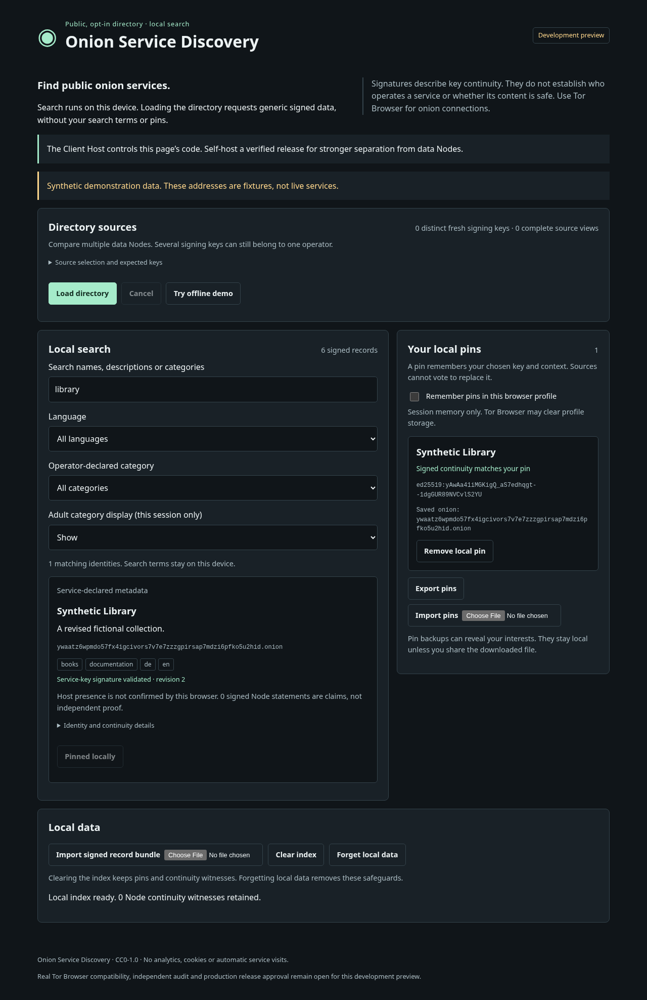
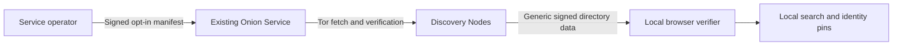

# Onion Service Discovery

**Find public Onion Services through signed, opt-in directories. Search locally. Keep identity continuity in your own hands.**

Onion Service Discovery lets operators publish signed metadata about their Tor
Onion Services. Discovery Nodes collect and verify that evidence; your browser
checks signed directory data and searches it on your device. Local identity pins
help detect conflicting histories, key changes and Onion migrations.

[Try it locally](#try-it-locally) · [Installation](docs/getting-started/installation.md) · [Publish your service](docs/getting-started/publisher.md) · [Run a Node](docs/getting-started/node.md) · [Evidence and limits](docs/getting-started/project-status.md)

**Current release channel: development preview.** The local demo and documented
operator workflows are executable. Public production approval, independent audits,
a public seed network and the complete external onboarding workflow remain open.
Use a staging installation for network operation. [Current status](docs/getting-started/project-status.md)
explains exactly what the evidence establishes.



*Screenshot from the executable local demo. The addresses are synthetic test
fixtures; they are not live services or a public directory.*

## Why this project?

- **Publication is opt-in.** Operators explicitly sign the metadata they want to make public.
- **Local search.** Loading a directory fetches generic signed data. Search terms, filters and identity pins stay on your device in the local-search mode.
- **Identity survives change.** Separate Service keys, countersigned rotation and signed Onion migration preserve a verifiable history.
- **Sources cannot vote away a fork.** Conflicting signed histories remain evidence; more Node keys do not make an identity authoritative.
- **Self-hostable building blocks.** PHP reference Node, Filesystem/SQLite storage and a bundled browser client, with reproducible development packages.

Signatures establish signed statements and key continuity. They do not establish
who operates a service, whether its content is safe, or whether several Node keys
belong to independent people. The Client Host controls the code delivered to your
browser; use a reviewed self-hosted build when that boundary matters.

## Try it locally

Requires **Node.js 24+**, its bundled npm, and Git. No Tor, PHP, signing keys or
public Onion Service are needed for this synthetic demonstration.

```sh
git clone https://github.com/ShawnJeromeMcCray/Onion-Service-Discovery.git
cd Onion-Service-Discovery/web-local-search-client
npm ci --ignore-scripts
npm run demo
```

Open **http://127.0.0.1:8080/onion-service-discovery/** in a current browser.
Click **Try offline demo**, search for `library`, then click **Pin this identity**.
You should see one matching synthetic library and one local pin. Synthetic results
have no visit links. Stop the server with **Ctrl+C**. If port 8080 is busy:

```sh
npm run demo -- --port 8081
```

The preview listens only on loopback and serves a fixed set of public assets.
Dependency installation needs Internet access; after building, the synthetic demo
uses local assets. The default branch `main` is a development preview, not a signed
stable release. [Detailed quickstart and troubleshooting](docs/getting-started/quickstart.md).

## Choose your role

| You want to… | Start here | What you need |
| --- | --- | --- |
| Explore local search and identity pins | [Local demo](docs/getting-started/quickstart.md) | Node.js; synthetic data only |
| Publish an existing Onion Service | [Operator contract](docs/operations/operator-contract.md), then the [Publisher guide](docs/getting-started/publisher.md) | Existing v3 Onion; separate offline Service key; PHP |
| Collect and serve discovery evidence | [Node guide](docs/getting-started/node.md) | PHP, local Tor SOCKS, private storage and a separate Node key |
| Host the browser client for selected Nodes | [Client Host installation](docs/getting-started/installation.md#client-host) | PHP, built client, Tor SOCKS and explicitly selected sources; no signing keys. Optionally let visitors add their own Nodes |
| Review or contribute | [Contributing](CONTRIBUTING.md) | Locked development toolchains and the test suite |

There is no approved public seed list. An empty source list is intentional.
For real sources, obtain Onion addresses and expected Node public keys through
independently chosen channels. Do not replace missing infrastructure with the
synthetic example addresses.

## How it works



The application does not modify Tor or read Tor private keys. Discovery Nodes
retain signed history and publish complete development snapshots. A browser
validates data before merging source views. [Exact-state snapshot membership](docs/operations/snapshot-membership.md)
can be checked offline with full owner history and an independently selected Node
key; that check alone does not prove freshness or network-wide discoverability.

Without JavaScript, operators can optionally enable [server-side HTML search](docs/operations/server-search.md).
That mode explicitly sends search terms to the selected Node and does not provide
local browser verification.

## Tested behavior and current boundaries

The current code includes three-language protocol/membership vectors, bounded
Tor transport, crash and disk-full recovery tests, resumable snapshot ancestry,
and browser privacy checks. Actual signature-verified Tor Browser tests pass over
an **isolated real private Tor network**, including a JavaScript-disabled profile.
Public Tor, Android and desktop Normal/Safer/Safest certification remain open.

See [the evidence map and comparison with the October 2026 assessment](docs/getting-started/project-status.md),
[measured capacity](docs/performance/README.md), [deployment and recovery](docs/operations/deployment-and-recovery.md),
and [machine-readable production gates](docs/production-readiness.json).
No test count is an independent security audit or production approval.

## Documentation and help

- [Installation and prerequisites](docs/getting-started/installation.md), [quickstart](docs/getting-started/quickstart.md), [troubleshooting](docs/getting-started/troubleshooting.md).
- [Five-minute operator contract](docs/operations/operator-contract.md): what becomes public, which key matters, how to withdraw.
- [Operator CLI](docs/operations/cli.md), [configuration reference](docs/operations/configuration.md), [error codes](docs/operations/error-codes.md), [offline signing](docs/signing/offline.md), [backup and recovery](docs/operations/deployment-and-recovery.md).
- [Draft protocol handbook](docs/protocol/handbook.md), [browser contract](docs/browser/client-contract.md), [decision register](docs/governance/decision-register.md).
- [Development package verification](docs/operations/release-candidate.md), [offline release verifier](release-tools/README.md).
- [Support](SUPPORT.md), [security reporting](SECURITY.md), [contributing](CONTRIBUTING.md), [changelog](CHANGELOG.md).

## License

Project code is dedicated to the public domain under [CC0-1.0](LICENSE), as approved
by the owner. Third-party code and Unicode data retain their own licenses; see
[third-party notices](THIRD_PARTY_NOTICES.md). No warranty is provided.
