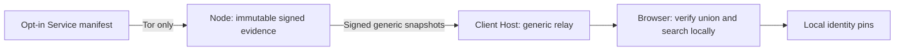

# Public protocol handbook — development implementation profile

This document describes implemented behavior and links the offline schemas,
fixtures and tests. **It is a draft, not Protocol Stable, IANA registration,
security certification or production approval.** Sources and unresolved human
choices remain in the specification manifest and decision register. Requirement
keywords follow RFC 2119/8174 within this development profile. The owner froze the
implemented protocol v1 bytes on 2026-10-14 (D-005 to D-017, D-052); independent
review remains open.

## Participants and trust

A Service operator controls a separate Ed25519 Service key and signs opt-in
metadata served on its exact canonical Tor v3 hostname. A Node mirrors verified
signed evidence and can make its own direct observation. A distinct Client Host
serves locally bundled verification/search code and may relay generic data from
explicitly configured Nodes and, only when its operator enables
`visitor_sources`, from Nodes the visitor chose. The browser combines multiple source views and
searches locally. Combined hosting is supported but has a weaker origin boundary.

Search terms and pins do not travel along these arrows. The hosting origin can
replace the browser code; signatures do not remove that origin-trust limitation.
No Node vote, count, timestamp or ranking chooses Service identity. Distinct Node
keys describe source coverage, not a Sybil solution or content endorsement.

## Encoding and exact signed bytes

Wire input is bounded UTF-8 JSON with duplicate/escape-equivalent keys, lone
surrogates, fractions/scientific notation, unsafe integers and unknown fields
rejected. The integer-only schema subset uses RFC 8785 serialization with UTF-16
property ordering. Unicode is preserved in signed fields, never normalized for
signing. Name/description normalization occurs only in local search.

An Onion is exactly 56 lowercase base32 characters plus `.onion`. Its decoded
public address bytes include Tor v3 version and SHA3 checksum. URL schemes,
ports, paths, whitespace and arbitrary destination URLs are not addresses.

Keys are `ed25519:` plus unpadded base64url of 32 bytes. Signatures encode 64
bytes as `ed25519sig:` plus unpadded base64url. Decoding is canonical and strict.
Both public key and R must be canonical, nonidentity prime-subgroup points;
noncanonical S is rejected by the mature signature implementations. PHP uses
libsodium, TypeScript locally bundled Noble, and independent Python PyNaCl point
validation plus cryptography signatures. The signature providers, point policy
and bytes need independent human crypto review.

The message is the UTF-8 ASCII string
`Onion Service Discovery/<domain>/v1`, one zero byte, then the canonical payload.
The payload excludes exactly the declared signature slots. Content hashes use
the corresponding `<domain>-hash/v1` domain and `sha256:` plus lowercase hex.
All other payload fields, including unknown fields if they were allowed in a
future profile, would affect signatures; v1 rejects unknown fields.

| Record | Signer | Domain | Excluded signature slots |
| --- | --- | --- | --- |
| service_manifest | Service | service-manifest | signature |
| service_identity_key_rotation | Old Service and new Service confirmation | service-key-rotation | old_key_signature, new_key_confirmation |
| onion_service_migration | Service | onion-migration | service_identity_signature |
| node_descriptor | Node | node-descriptor | signature |
| direct_observation | Observing Node | direct-observation | signature |
| snapshot_descriptor | Source Node | snapshot-descriptor | signature |

Exact required/optional fields, bounds and date/key patterns are in the six
[schemas](../../protocol/schemas). Optional description, links and published_at
may be absent; absent and explicit null are distinct. RFC 8785-style canonical
bytes are defined for this bounded integer subset, not arbitrary floating JSON.
Shared positive/negative vectors include absent optional metadata and strict
Ed25519 edge cases; the black-box runner imports no application implementation.

## Identity lifecycle

Genesis is revision 1 with explicit null predecessor. Successors require exact
revision +1 and the predecessor's exact content hash. Missing history is pending.
The evidence graph retains competing signed branches as a sticky fork; it does
not use arrival order or clocks to choose one. Two roots sharing an Onion remain
distinct identities. A copied TypeScript object is not a VerifiedRecord: the
verifier brands actual results privately and provenance is lost on serialization.

A Service also serves its complete public history at
`/.well-known/onion-service-discovery-history.json` (PCP-004): an unsigned
bundle of at most 256 individually signed Manifests and proofs (1 MiB). A Node
fetches it only when a fetched Manifest does not connect to history it holds and
keeps only records that belong to that identity; a bundle cannot hide a fork.

Rotation is countersigned by old/new keys and committed only together with its
first valid successor. Migration authorizes the new Onion through a signed proof
and successor. Combined rotation/migration needs both independently valid proofs
anchored to the same predecessor. Withdrawal is a new signed revision with
publish_service false and removes normal active results. Necessary public
continuity, withdrawal and conflict evidence can remain. A never-published
identity is excluded from public snapshots, deltas, lookup and public archives;
trusted private backups retain it.

Local pins preserve the genesis key, context Onion, anchor/current hashes,
highest revision and a sticky conflict. New addresses/keys need actual signed
continuity; unchanged names or source votes do not transfer pins. Default pins
are session memory; persistent profile saving is explicit and may be unavailable
in Tor Browser. Export/import is local, bounded and explicitly reviewed. No
cloud/account sync exists. Losing a Service key does not create social recovery.

## Node data, transport and synchronization

Read-only fixed endpoints under `/onion-service-discovery/v1/` are node, state,
peers, services/{onion}, services/by-id/{logical_service_id},
changes?after={local-sequence}, snapshots/{hash} and chunks/{hash}; Services
serve `/.well-known/onion-service-discovery.json` and the PCP-004 history bundle
`/.well-known/onion-service-discovery-history.json`. Only GET/HEAD are supported; methods, extra query parameters and
arbitrary URLs are rejected. Signed descriptors authenticate source data;
unsigned state is only a locator checked against the signed checkpoint.
Mirror Nodes advertise index.core.v1, sync.changes.v1 and sync.snapshots.v1.
Outbound peer consumption is a separate configuration flag. Public responses have
finite bytes/records/time and aggregate rate limits.
Service lookup uses a derived index and can return 413 for long histories;
complete bounded history is available through snapshot sync.

Onion HTTP uses configured loopback SOCKS5 with remote hostname resolution,
per-request stream isolation and no direct fallback, redirects, netrc, proxy
bypass or compressed-body acceptance. No application code reads Tor private
keys. Controlled tests prove the transport adapter's observable behavior; live
Tor evidence remains separate.

Snapshot chunks are exact canonical record arrays, globally ordered by content
hash with no duplicates and no recursively embedded snapshot descriptor.
Chunk hash: SHA-256 of `Onion Service Discovery/snapshot-chunk/v1`, zero byte,
then exact chunk bytes. Root hash uses `snapshot-root/v1`, zero byte, then the
canonical ordered array of `{hash,bytes,record_count}` chunk descriptors.
All length, count, root, chunk and individual signature checks are mandatory.

Peer sync is bounded and resumable: at most six requests/two chunks per step.
A manual expected Node-key pin cannot silently change. Checkpoint generations
have high-water marks and sticky signed equivocation evidence. A source cursor
activates only after a complete verified snapshot; omission never deletes global
evidence. Valid records from a failed partial transfer can remain as evidence,
not as a completed source view. First contact at a higher generation is explicitly
an unproven history baseline. Remote observations/assertions never become local
observations. Seven-day local provenance assertions describe source/checkpoint
receipt and are replaceable hints; signed history/conflicts are not pruned with
these hints. Optional discovery queues at most 32 new directly-checkable
candidates per sync step and requires its explicit feature flag.

## Storage, operation and releases

Required FilesystemStore and additional SQLiteStore share append-only record,
atomic data/cursor, rollback, quota and backend-neutral tests. Filesystem format 2 writes a durable journal COMMIT before publishing HEAD.
A committed successor with a lagging HEAD is completed during explicit recovery;
PREPARE without COMMIT remains inactive. Legacy format 1 requires explicit
migration preserving its historical HEAD commit interpretation. SQLite uses WAL, FULL synchronous commits and foreign keys. Read-only
HTTP/diagnostics never initiate journal repair or application transactions.
Doctor reports pending recovery; an explicit operator action performs it.

Public archive import verifies evidence but restores no local authority. Trusted
private backups preserve operational state and require private authenticated
backup custody, empty staging and isolated restore checks. Keys, config, exports
and persistent release-verifier state need separate backups. Old backup restore
must not erase known higher revisions or run concurrently with the same Node key.
See the [operator runbook](../operations/deployment-and-recovery.md).

There is no silent self-update or downloaded-code execution. An established
python-tuf verifier checks offline metadata, expiration, thresholds, hashes and
rollback, supplemented by signed software sequence/profile policy. A production
out-of-band root, threshold decisions and independent release/recovery ceremony
are not invented. Reproducible source/browser candidates include a dependency
inventory and checksums; unsigned local provenance is not authenticated builder
provenance. See [release gates](../release-gates.json).

## Interoperability and non-claims

The black-box suite runs 248 cases per PHP/TypeScript/Python in CI (the latest
committed report recorded 226, before the PCP-004 history cases), with bounded
malformed-input smoke fuzzing and finite formal safety evidence. These do not
certify all CORE-V1/API/SYNC profiles or prove unbounded/liveness properties.
Controlled Chromium is not Tor Browser desktop/Android. S1000 local benchmarks
are not live multi-Node Tor capacity or mobile suitability.

Valid signatures do not establish content safety, honesty, legal/human identity,
name ownership, global completeness, global deletion, immediate freshness or
Tor Project approval. Local query privacy assumes unmodified client code and
an uncompromised origin/endpoint. Higher scale, optional extensions, external
proofs and moderation cannot override identity validity. The offline source
corpus, exact schema/vector files, implementation status and known limitations
travel with development artifacts; human review remains required for a stable
standard and a public production release.

## Updated category and language draft

Category Registry v1 uses the 38 machine-readable IDs, including adult; generated
schema membership rejects unknown IDs. Local display labels are outside signed
bytes. Tags are absent and cannot be substituted into category identifiers.
The current language experiment uses lowercase RFC 5646 well-formed tags with
no duplicate variants/extension singletons. Limits remain 35 ASCII characters
and 16 entries. This is syntax validation, not registered-language validation.
See PCP-001 for compatibility and the unresolved D-053/D-054 freeze approvals.
